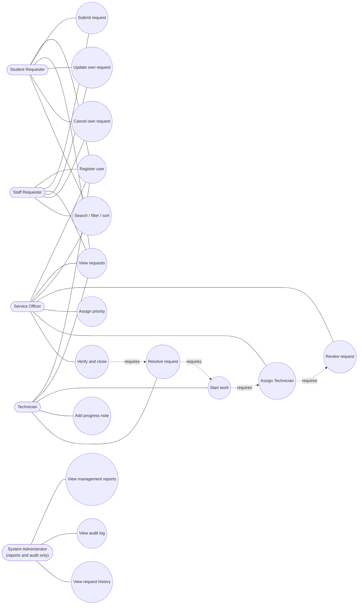
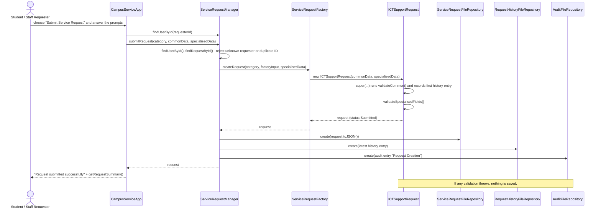
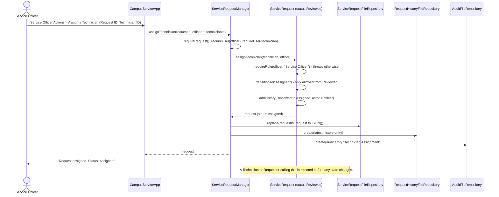
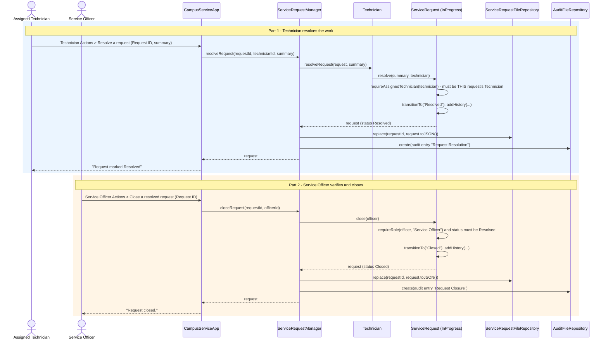

# UML and System Design

All diagrams were written for the **final submitted code** (the `distinction-extension` folder). They are Mermaid diagrams: GitHub draws them automatically when you open this page. The same diagrams are also saved as separate files in `docs/diagrams/`. Every class, field and method named in the class diagram was checked against the source files.

## 1. Use case diagram

Four roles act on the system. The dotted "requires" lines show the workflow order that the code enforces: a Technician cannot be assigned before a review, work cannot start before an assignment, and so on. The System Administrator is drawn because the brief names the role, but in this version it has no login or class: reports, history and the audit log are open menu options.

## 2. Class diagram

```mermaid
classDiagram
    class User {
        -userId
        -firstName
        -lastName
        -email
        -userType
        +getUserId()
        +getFullName()
        +getRole()
        +setEmail(email)
        +validate()
        +displayInfo()
        +toJSON()
    }
    class StudentRequester {
        -programme
        -yearLevel
        +getRole()
        +toJSON()
        +fromJSON(data)$
    }
    class StaffRequester {
        -department
        +getRole()
        +toJSON()
        +fromJSON(data)$
    }
    class ServiceOfficer {
        -serviceSection
        +getRole()
        +reviewRequest(request)
        +assignPriority(request, priority)
        +assignTechnician(request, technician)
        +closeRequest(request)
        +toJSON()
        +fromJSON(data)$
    }
    class Technician {
        -technicalSpeciality
        -available
        +getRole()
        +isAvailable()
        +startWork(request)
        +addProgressNote(request, note)
        +resolveRequest(request, summary)
        +toJSON()
        +fromJSON(data)$
    }
    User <|-- StudentRequester
    User <|-- StaffRequester
    User <|-- ServiceOfficer
    User <|-- Technician

    class UserFactory {
        +createFromData(savedData)$
    }
    UserFactory ..> StudentRequester : creates
    UserFactory ..> StaffRequester : creates
    UserFactory ..> ServiceOfficer : creates
    UserFactory ..> Technician : creates

    class ServiceRequest {
        <<abstract>>
        -requestId
        -requester
        -title
        -description
        -location
        -category
        -priority
        -status
        -assignedTechnician
        -progressNotes
        -resolutionSummary
        -history
        +getRequestType()
        +getStatus()
        +validateCommon()
        +validateSpecialisedFields()*
        +calculatePriorityScore()*
        +getTargetResolutionHours()*
        +getRequestSummary()*
        +getBasePriorityScore()
        +getBaseSummary()
        +updateDetails(changes, actor)
        +cancelRequest(actor)
        +review(actor)
        +setPriority(priority, actor)
        +assignTechnician(technician, actor)
        +startWork(technician)
        +addProgressNote(note, technician)
        +resolve(summary, technician)
        +close(actor)
        +getHistory()
        +toJSON()
        +_restoreState(savedData)
    }
    class ICTSupportRequest {
        -deviceType
        -systemName
        -faultType
        -networkImpact
        +validateSpecialisedFields()
        +calculatePriorityScore()
        +getTargetResolutionHours()
        +getRequestSummary()
        +toJSON()
    }
    class MaintenanceRequest {
        -building
        -roomNumber
        -hazardLevel
        -equipmentAffected
        +validateSpecialisedFields()
        +calculatePriorityScore()
        +getTargetResolutionHours()
        +getRequestSummary()
        +toJSON()
    }
    class CleaningRequest {
        -cleaningArea
        -hygieneRisk
        -serviceType
        -preferredServiceTime
        +hasHygieneRisk()
        +validateSpecialisedFields()
        +calculatePriorityScore()
        +getTargetResolutionHours()
        +getRequestSummary()
        +toJSON()
    }
    class GeneralServiceRequest {
        -generalServiceType
        +validateSpecialisedFields()
        +calculatePriorityScore()
        +getTargetResolutionHours()
        +getRequestSummary()
        +toJSON()
    }
    ServiceRequest <|-- ICTSupportRequest
    ServiceRequest <|-- MaintenanceRequest
    ServiceRequest <|-- CleaningRequest
    ServiceRequest <|-- GeneralServiceRequest

    class ServiceRequestFactory {
        +createRequest(category, commonData, specialisedData)$
        +createFromData(savedData, requesterRef)$
    }
    ServiceRequestFactory ..> ICTSupportRequest : creates
    ServiceRequestFactory ..> MaintenanceRequest : creates
    ServiceRequestFactory ..> CleaningRequest : creates
    ServiceRequestFactory ..> GeneralServiceRequest : creates

    class BaseFileRepository {
        -filePath
        -idField
        +loadAll()
        +saveAll(records)
        +findById(id)
        +create(record)
        +update(id, changes)
        +replace(id, record)
    }
    class UserFileRepository {
        +findByRole(role)
    }
    class ServiceRequestFileRepository {
        +findByRequester(userId)
        +findByTechnician(technicianId)
        +findByStatus(status)
    }
    class RequestHistoryFileRepository {
        +findByRequestId(requestId)
    }
    class AuditFileRepository {
        +findByRequestId(requestId)
        +findByActor(actorId)
    }
    BaseFileRepository <|-- UserFileRepository
    BaseFileRepository <|-- ServiceRequestFileRepository
    BaseFileRepository <|-- RequestHistoryFileRepository
    BaseFileRepository <|-- AuditFileRepository

    class fileStore {
        <<module>>
        +loadJSONArray(filePath)
        +saveJSONArray(filePath, records)
    }
    BaseFileRepository ..> fileStore : only file I/O

    class ServiceRequestManager {
        -users
        -requests
        +init()
        +registerUser(user)
        +findUserById(userId)
        +getUsersByType(role)
        +submitRequest(category, commonData, specialisedData)
        +findRequestById(requestId)
        +getRequestsByUser(userId)
        +getRequestsByTechnician(technicianId)
        +updateRequest(requestId, userId, changes)
        +cancelRequest(requestId, userId)
        +reviewRequest(requestId, officerId)
        +assignPriority(requestId, officerId, priority)
        +assignTechnician(requestId, officerId, technicianId)
        +closeRequest(requestId, officerId)
        +startWork(requestId, technicianId)
        +addProgressNote(requestId, technicianId, note)
        +resolveRequest(requestId, technicianId, summary)
        +searchRequests(searchText)
        +filterByCategory(category)
        +filterByStatus(status)
        +filterByPriority(priority)
        +sortByPriorityScore(requests)
        +sortByDateSubmitted(requests, ascending)
        +getRequestSummaryByStatus()
        +getRequestHistory(requestId)
    }
    ServiceRequestManager "1" *-- "many" User : holds in memory
    ServiceRequestManager "1" *-- "many" ServiceRequest : holds in memory
    ServiceRequestManager "1" o-- "4" BaseFileRepository : persists through
    ServiceRequestManager ..> UserFactory : restores users
    ServiceRequestManager ..> ServiceRequestFactory : creates and restores

    class ReportService {
        +requestsByStatus()
        +requestsByCategory()
        +requestsByPriority()
        +urgentRequests()
        +overdueRequests()
        +requestsByTechnician()
        +completedRequestsByTechnician()
        +averageResolutionHours()
        +requestVolumeByLocation()
        +fullReport()
    }
    ReportService ..> ServiceRequestManager : reads

    class CampusServiceApp {
        <<console>>
        +main()
    }
    CampusServiceApp ..> ServiceRequestManager : uses
    CampusServiceApp ..> ReportService : uses
```

### 2.1 How the classes relate

- **Inheritance.** `StudentRequester`, `StaffRequester`, `ServiceOfficer` and `Technician` extend `User`. `ICTSupportRequest`, `MaintenanceRequest`, `CleaningRequest` and `GeneralServiceRequest` extend `ServiceRequest`. The four repositories extend `BaseFileRepository`. Every subclass constructor starts with `super(...)`.
- **Abstraction.** `ServiceRequest` is abstract: `new ServiceRequest(...)` throws, and `calculatePriorityScore()`, `getTargetResolutionHours()`, `getRequestSummary()` and `validateSpecialisedFields()` throw `Abstract Method Error` until a subclass overrides them. Subclasses reuse common code through two ordinary helper methods, `getBasePriorityScore()` and `getBaseSummary()`.
- **Polymorphism.** `ServiceRequestManager` stores every request as a plain `ServiceRequest`. Reports, sorting and the console call the same method names on each one and get category-specific results (for example target resolution hours 8, 4, 2 and 72 for ICT with network impact, Maintenance with high hazard, Cleaning with hygiene risk, and General).
- **Composition.** The Manager holds its users and requests in memory (they exist as long as the Manager does). A `ServiceRequest` owns its history entries.
- **Aggregation.** The Manager is given four repository objects when it is built, which is how the tests point it at temporary folders.
- **Dependency.** The two factories are used by the Manager but hold no state. `ReportService` only reads from the Manager. `CampusServiceApp` calls the Manager and `ReportService` and never touches a file.
- **Why permission checks sit in `ServiceRequest`.** Each workflow method receives the person acting and checks their role (or, for a Technician, their ID against the assigned Technician) before changing anything. The rules therefore hold no matter what calls the method.

## 3. Sequence diagram - submitting a request

## 4. Sequence diagram - assigning a Technician

## 5. Sequence diagram - resolving and closing a request

